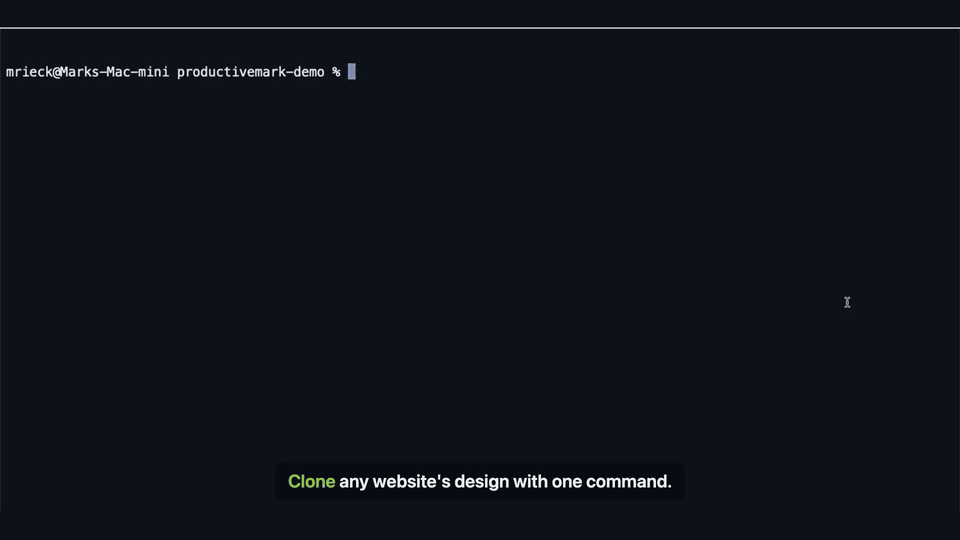
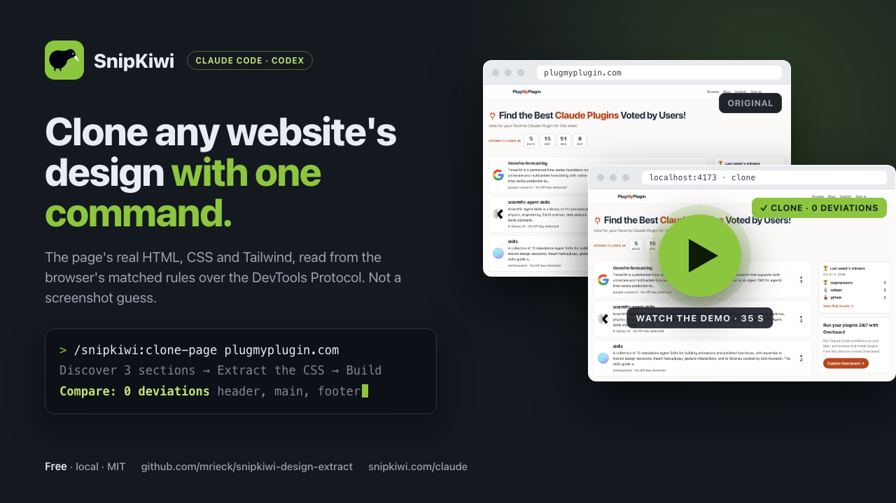

<div align="center">

# SnipKiwi

**Clone any website's design with one command**

The SnipKiwi CLI gets the real HTML, CSS and Tailwind from the matched rules in Chrome DevTools
Protocol and hands it off to your agent to integrate into your design.

Works in Claude Code and Codex CLI. Free and local, with no account to create.

[Quick Start](#quick-start) · [Watch Demo](#demo) · [Docs](https://snipkiwi.com/claude)

[](LICENSE)
[](https://github.com/mrieck/snipkiwi-design-extract/stargazers)


</div>

## Demo



[](https://youtu.be/LwcFwTGIpSE)

Click the image to watch the full demo.

## Quick Start

**1. Install**

In Claude Code:

```
/plugin marketplace add mrieck/snipkiwi-design-extract
/plugin install snipkiwi@snipkiwi
```

<details>
<summary>Codex CLI</summary>

```sh
git clone https://github.com/mrieck/snipkiwi-design-extract ~/snipkiwi
cd ~/snipkiwi && npm install --omit=dev
codex mcp add snipkiwi -- node ~/snipkiwi/dist/mcp-server.js
```

Complex pages can take a while, so raise the timeout in `~/.codex/config.toml`:

```toml
[mcp_servers.snipkiwi]
tool_timeout_sec = 120
```

</details>

You need Node 18 or newer and Google Chrome. If Chrome is missing, SnipKiwi uses a bundled
Chromium and tells you how to fetch it.

**2. Clone a page**

```
/snipkiwi:clone-page plugmyplugin.com
```

Or grab one section:

```
/snipkiwi:extract the homepage upvote list on plugmyplugin.com
```

Ask for changes in plain words: "but with our logo", "in our colors", "drop the sidebar". You can
also skip the command and say "make our sidebar look like the one on plugmyplugin.com".

## What your agent gets

You give the URL and say what you want. Your agent does the rest with what SnipKiwi hands it:

- A numbered map of the page, so "the pricing cards" resolves to a selector without you looking
  at any code.
- The CSS as the site's author wrote it. Media queries, `:hover` rules, `@font-face`, `@keyframes`
  and `var()` references come through, so what the agent builds still responds to screen size.
- A Tailwind version of every section, for projects that use it.
- A difference report after the build. SnipKiwi screenshots the agent's page and the source at the
  same width and lists what is off, like "your padding is 16px, reference is 24px". The agent
  fixes the list and runs it again.

## Supported platforms

| Agent | Status |
| --- | --- |
| Claude Code | Recommended |
| Codex CLI | Supported |

## CLI

The extractor also runs on its own:

```sh
node dist/index.js --url https://plugmyplugin.com --list                # discover selectors
node dist/index.js --url https://plugmyplugin.com --selector header --format both
node dist/index.js --url https://plugmyplugin.com --selector header --open   # preview files in a browser
```

Flags: `--viewport all|responsive|desktop|tablet|mobile|<px>`, `--format css|tailwind|both|json|html`,
`--no-hover`, `--resolve-vars`, `--timeout 30000`, `--output <path>`. See
[docs/EXTRACTOR_DEBUGGING.md](docs/EXTRACTOR_DEBUGGING.md).

## Development

```sh
npm install
npm run build          # tsc → dist/ (dist/*.js is committed so the plugin runs from a git checkout)
npm run check          # build + MCP smoke test (tools/list)
```

To test from a local checkout, run `/plugin marketplace add /path/to/snipkiwi-design-extract` and
then `/plugin install snipkiwi@snipkiwi`. Claude Code only picks up a new copy when `version` in
`.claude-plugin/plugin.json` changes. [CLAUDE.md](.claude/CLAUDE.md) describes the architecture.

## License

[MIT](LICENSE) © Productive Mark LLC. This is the successor to the SnipCSS plugin. The old
`@productivemark/snipcss` npm package stays frozen at 1.1.4.
